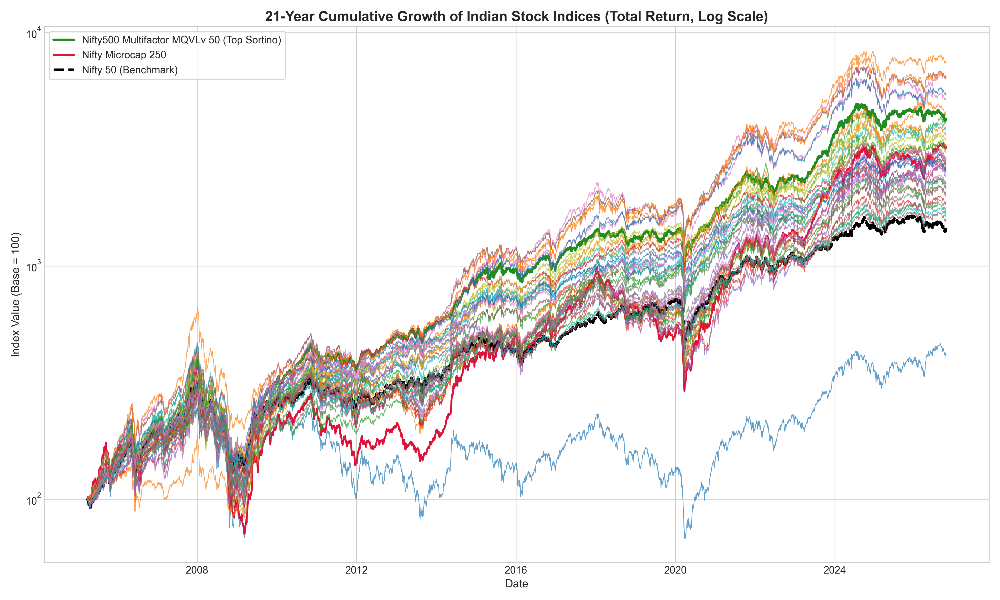
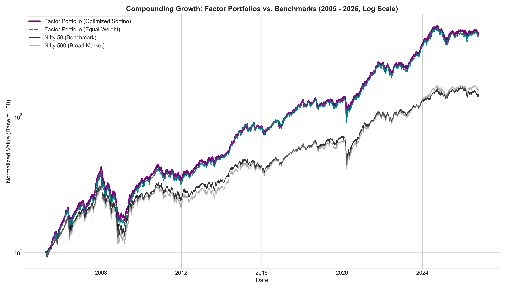
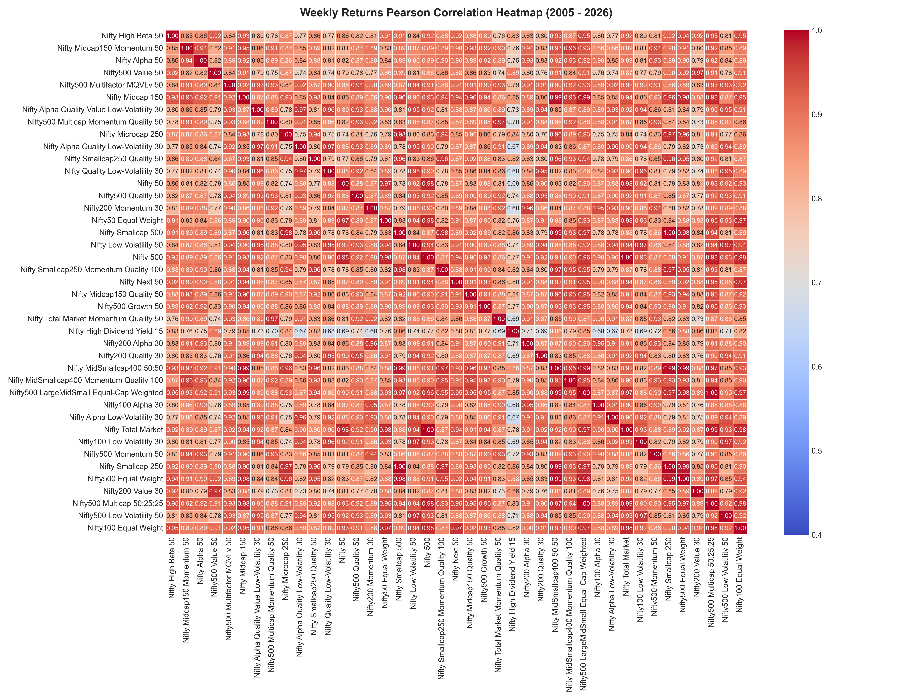

# Nifty Factor Analytics

A quantitative study and interactive Dash dashboard comparing **41 Indian NSE indices** (8 broad-market, 6 alternative-weighting and 27 factor indices: every NSE strategy index with history back to April 2005) on **Total Return Index (TRI)** data, i.e. with dividends reinvested, from **1 Apr 2005 to 16 Oct 2026**.

- Downloads daily TRI history directly from niftyindices.com and caches it year by year.
- Dashboard tabs: sortable metrics tables for lumpsum, rolling returns and monthly SIP (cumulative and rolling), a **two-index Deep Dive** (rolling-return distributions, excess-return distribution, worst/median/best windows, drawdown episodes, calendar years, capture ratios) and a correlation tab (raw weekly-return heatmap plus an **excess-return** heatmap that removes a chosen benchmark's move to show real diversification, a sortable one-fund-vs-all-others table, and the most diversifying pairs).
- Every table reports volatility, downside volatility, the **Sharpe** and **Sortino** ratios and a **risk-adjusted return (M²)** at a risk-free rate you set in the dashboard, plus a **95% confidence interval** for that table's return statistic (block bootstrap; not the range of single-year returns).
- A pre-executed Jupyter notebook covers the same metrics plus a 3-factor Sortino optimiser.

## Results (1 Apr 2005 – 16 Oct 2026)

Sorted by Sortino. All measures use weekly returns and a 6% risk-free rate. Sharpe = mean excess return / its standard deviation; Sortino = mean excess return / downside deviation below the risk-free rate (both annualised); risk-adjusted return (M²) = risk-free rate + Sharpe × Nifty 50 volatility, an average-return figure for comparing indices with each other. The last column comes from 4,106 overlapping 5-year windows.

| Index | CAGR | Volatility | Downside Vol | Sharpe | Sortino | Risk-adj. return (M²) | Max DD | 5Y rolling CAGR: median / worst |
| :--- | ---: | ---: | ---: | ---: | ---: | ---: | ---: | ---: |
| Nifty Total Market Momentum Quality 50 | 20.38% | 19.05% | 12.93% | 0.76 | 1.09 | 20.88% | -59.04% | 22.26% / 5.05% |
| Nifty500 Multifactor MQVLv 50 | 19.03% | 17.45% | 11.71% | 0.75 | 1.08 | 20.65% | -53.93% | 18.94% / 1.71% |
| Nifty Midcap150 Momentum 50 | 22.14% | 22.04% | 14.99% | 0.75 | 1.08 | 20.70% | -72.52% | 23.97% / 1.16% |
| Nifty500 Multicap Momentum Quality 50 | 20.08% | 18.99% | 12.94% | 0.75 | 1.07 | 20.66% | -60.06% | 22.13% / 4.35% |
| Nifty MidSmallcap400 Momentum Quality 100 | 21.36% | 21.47% | 14.60% | 0.74 | 1.06 | 20.39% | -68.04% | 21.45% / 1.54% |
| Nifty500 Low Volatility 50 | 16.96% | 15.58% | 10.44% | 0.71 | 1.02 | 19.82% | -48.26% | 15.74% / 2.81% |
| Nifty500 Momentum 50 | 21.25% | 22.68% | 15.48% | 0.71 | 1.01 | 19.78% | -70.24% | 21.59% / -4.38% |
| Nifty Alpha Low-Volatility 30 | 17.62% | 16.82% | 11.57% | 0.70 | 0.99 | 19.70% | -57.31% | 17.96% / 4.19% |
| Nifty Alpha Quality Low-Volatility 30 | 16.98% | 16.10% | 11.01% | 0.69 | 0.98 | 19.49% | -49.00% | 17.68% / 3.10% |
| Nifty Smallcap250 Momentum Quality 100 | 21.31% | 24.32% | 16.59% | 0.68 | 0.97 | 19.20% | -72.43% | 21.92% / 0.73% |
| Nifty Alpha Quality Value Low-Volatility 30 | 16.84% | 16.29% | 11.10% | 0.68 | 0.96 | 19.23% | -53.73% | 17.24% / 3.13% |
| Nifty100 Low Volatility 30 | 16.47% | 16.12% | 10.78% | 0.66 | 0.96 | 18.95% | -48.65% | 15.84% / 2.19% |
| Nifty Low Volatility 50 | 16.40% | 15.97% | 10.81% | 0.66 | 0.95 | 18.98% | -51.25% | 15.97% / 2.83% |
| Nifty High Dividend Yield 15 | 19.51% | 24.78% | 15.77% | 0.61 | 0.93 | 17.82% | -56.84% | 18.80% / -4.73% |
| Nifty200 Quality 30 | 16.77% | 17.43% | 11.67% | 0.64 | 0.93 | 18.52% | -55.57% | 16.69% / 1.33% |
| Nifty Midcap150 Quality 50 | 17.34% | 18.54% | 12.43% | 0.64 | 0.93 | 18.48% | -58.51% | 17.81% / 2.63% |
| Nifty Quality Low-Volatility 30 | 15.51% | 15.35% | 10.45% | 0.63 | 0.90 | 18.40% | -47.44% | 15.98% / 0.40% |
| Nifty500 Quality 50 | 16.49% | 17.91% | 12.06% | 0.62 | 0.89 | 18.01% | -53.60% | 16.56% / -0.64% |
| Nifty200 Momentum 30 | 18.20% | 21.16% | 14.46% | 0.62 | 0.88 | 18.10% | -67.69% | 19.58% / -1.98% |
| Nifty Smallcap250 Quality 50 | 18.00% | 21.91% | 14.97% | 0.60 | 0.85 | 17.68% | -70.26% | 18.89% / -1.51% |
| Nifty500 Growth 50 | 18.48% | 24.53% | 16.89% | 0.58 | 0.82 | 17.26% | -76.15% | 18.13% / -3.73% |
| Nifty Alpha 50 | 18.77% | 25.10% | 17.82% | 0.58 | 0.80 | 17.32% | -78.88% | 19.84% / -6.92% |
| Nifty200 Alpha 30 | 17.42% | 23.30% | 16.41% | 0.56 | 0.77 | 16.86% | -75.34% | 18.38% / -8.09% |
| Nifty Midcap 150 | 16.69% | 22.33% | 15.28% | 0.54 | 0.77 | 16.56% | -72.89% | 16.87% / -2.34% |
| Nifty500 LargeMidSmall Equal-Cap Weighted | 15.70% | 21.25% | 14.57% | 0.52 | 0.74 | 16.10% | -68.35% | 15.28% / -1.96% |
| Nifty Microcap 250 | 17.50% | 27.38% | 18.88% | 0.51 | 0.73 | 16.01% | -82.04% | 15.51% / -11.93% |
| Nifty MidSmallcap400 50:50 | 16.20% | 23.24% | 16.00% | 0.51 | 0.73 | 15.98% | -74.25% | 15.57% / -4.17% |
| Nifty500 Multicap 50:25:25 | 15.13% | 20.58% | 14.11% | 0.50 | 0.72 | 15.83% | -66.79% | 14.74% / -1.58% |
| Nifty Smallcap 500 | 16.31% | 24.94% | 17.20% | 0.50 | 0.70 | 15.69% | -77.61% | 15.16% / -6.49% |
| Nifty200 Value 30 | 16.03% | 26.93% | 17.55% | 0.47 | 0.70 | 15.14% | -63.09% | 13.22% / -8.42% |
| Nifty100 Alpha 30 | 15.36% | 21.08% | 14.86% | 0.51 | 0.70 | 15.89% | -72.85% | 16.46% / -6.07% |
| Nifty500 Value 50 | 16.24% | 27.01% | 17.88% | 0.47 | 0.70 | 15.27% | -66.06% | 14.87% / -8.13% |
| Nifty50 Equal Weight | 14.14% | 20.23% | 13.56% | 0.47 | 0.68 | 15.09% | -58.25% | 12.48% / -4.46% |
| Nifty Smallcap 250 | 15.56% | 24.63% | 16.97% | 0.47 | 0.67 | 15.24% | -75.56% | 14.07% / -6.17% |
| Nifty100 Equal Weight | 14.30% | 20.96% | 14.10% | 0.46 | 0.67 | 15.04% | -63.00% | 13.67% / -2.79% |
| Nifty Next 50 | 14.97% | 23.09% | 15.77% | 0.47 | 0.67 | 15.11% | -72.13% | 14.42% / 0.26% |
| Nifty Total Market | 13.95% | 19.88% | 13.62% | 0.46 | 0.66 | 15.02% | -64.22% | 13.60% / -1.48% |
| Nifty 500 | 13.71% | 19.81% | 13.57% | 0.45 | 0.64 | 14.83% | -63.71% | 13.38% / -1.40% |
| Nifty500 Equal Weight | 14.54% | 23.30% | 15.91% | 0.45 | 0.64 | 14.75% | -70.23% | 14.00% / -5.11% |
| Nifty 50 | 13.26% | 19.53% | 13.23% | 0.44 | 0.63 | 14.51% | -59.50% | 12.97% / -1.03% |
| Nifty High Beta 50 | 6.88% | 33.32% | 22.99% | 0.19 | 0.27 | 9.73% | -78.72% | 4.29% / -15.90% |

Highlights:
- 16 of the 41 indices never had a negative 5-year window. The Momentum + Quality blends were the most robust (worst: +5.05% Total Market MQ 50, +4.35% Multicap MQ 50).
- Highest CAGR: Nifty Midcap150 Momentum 50 (22.14%). Lowest: Nifty High Beta 50 (6.88%, with -78.7% max drawdown), the mirror image of the low-volatility indices.
- Against the Nifty 50, MQVLv 50 won in 89% of 5-year windows and in 100% of 10-year windows.
- The notebook's Sortino-optimal blend (~65% Low Volatility, ~35% Momentum, 0% Quality) reaches a Sortino of 1.04, which does **not** beat Low Volatility alone (1.05). (The notebook keeps its own simpler (CAGR − rf) / downside volatility Sortino, so its figures differ from the table above.)





## Project structure

```text
index_analysis/
├── app.py                        # Dash dashboard (UI + callbacks)
├── analytics.py                  # All calculations used by the dashboard (pure functions)
├── download_new_indices.py       # Fetches TRI data from niftyindices.com → cache/ → data/
├── Indian_Indices_Analysis.ipynb # Pre-executed research notebook; writes results/*.png
├── tests/                        # Unit tests (analytics) + end-to-end tests (Dash HTTP callbacks)
├── cache/                        # Raw per-index, per-year API responses
├── data/                         # One merged daily TRI CSV per index (read by app + notebook)
├── results/                      # Notebook charts + weekly correlation matrix CSV
├── reference/                    # NSE equity index catalogue with TRI history start dates
├── requirements.txt
└── AGENTS.md                     # Maintainer / agent notes: methodology, known issues
```

## Quick start

```bash
pip install -r requirements.txt
python download_new_indices.py   # first run only: fetches all 41 indices into data/ (a few minutes)
python app.py
```

`data/` and `cache/` are not in the repository: the index data belongs to NSE Indices Limited, so each clone downloads its own copy from niftyindices.com. The code is MIT-licensed (see `LICENSE`); the data is not covered by that licence.

Open http://127.0.0.1:4400/.

## Usage

```bash
# Refresh data to today (re-fetches the current year; past years come from cache/)
python download_new_indices.py

# Run the dashboard at http://127.0.0.1:4400/
python app.py

# Run all tests (unit + end-to-end)
python -m unittest discover -s tests -t .

# Re-run the notebook in place, regenerating results/*.png with the latest data
jupyter nbconvert --to notebook --execute --inplace Indian_Indices_Analysis.ipynb
```

The downloader prints one `SUCCESS` line per index, for example:

```text
SUCCESS: Saved Nifty 50 TRI to data/Nifty_50_TRI.csv (5331 records, 2005-04-01 to 2026-09-28)
```

If an index is missing any year, the downloader keeps the existing file for that index and exits with status 1.

All tabs follow the global date range. The Deep Dive tab compares **lumpsum** rolling returns (a one-time investment, no SIP). It has its own Fund A / Fund B pickers and the same 1–10 year window slider as the other rolling tabs. Its histogram x-axes stay fixed (the min/max across all 1–10 year windows for the chosen pair) so you can compare windows directly.
